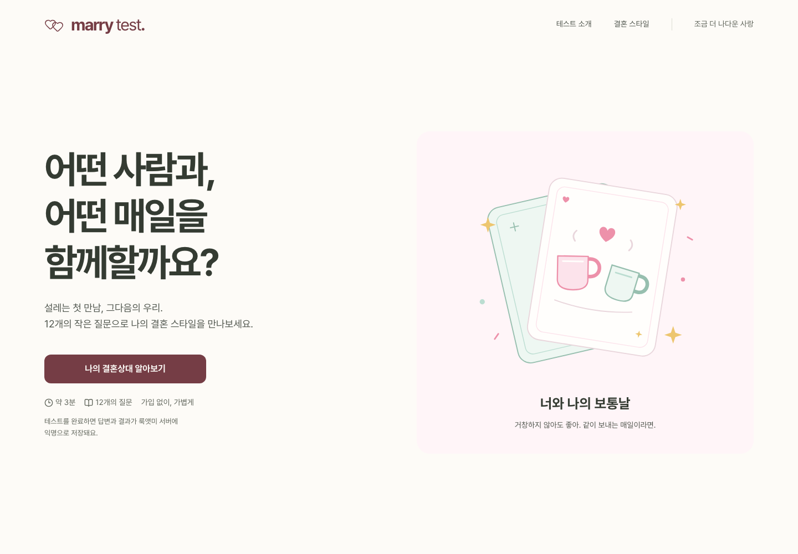

# lookatme-marry-test

**어떤 사람과, 어떤 매일을 함께할까요?**

`marry-test`는 결혼을 생각하는 사람들을 위한 한국어 관계 취향 테스트입니다. Next.js App Router로 화면을 제공하고, 완료한 답변을 기존 룩앳미 NestJS API로 전송해 PostgreSQL에 저장합니다.



## 실행

Node.js 22.12 이상을 사용합니다.

```sh
npm ci
cp .env.example .env.local
npm run dev
```

주소는 `http://localhost:4173`입니다. 아래 백엔드 실행까지 준비하면 저장도 동작합니다. API가 연결되지 않으면 결과는 볼 수 있고, 저장 실패 안내와 재시도 버튼이 표시됩니다.

```sh
npm run build       # Next.js 프로덕션 빌드 + TypeScript 검사
npm start           # 빌드한 서버 실행
npm test            # 점수 계산 · 저장 계약 · 서버 API 경계 테스트
npm run typecheck
npm run test:e2e     # 독립 UI 테스트 + Next.js 이전 테스트
```

브라우저 테스트는 최초 한 번 `npx playwright install chromium webkit`이 필요합니다. 물리 기기 대신 데스크톱 Chromium, Android Chromium, iPhone WebKit 에뮬레이션을 사용합니다.

## 구현된 경험

- 12개 생활 장면 질문: 앞 6개는 나의 모습, 뒤 6개는 원하는 상대.
- 일상·함께 보내는 시간·마음을 나누는 방식의 세 축과 8가지 결혼 스타일.
- 답변 수정, 탭 내 진행 저장 및 이어하기, 새로 시작하기.
- 배우자 선호 설명과 첫 만남 대화 질문 3개.
- 직접 제작한 SVG 일러스트 4종과 모바일 반응형 화면.
- 결과 카드 PNG 저장, Web Share API, 클립보드와 수동 복사 대안.
- 완료 시 익명 결과 자동 저장. 실패 시 재시도, 새로고침·동시 재전송의 중복 저장 방지.
- 공유 페이지에는 일반 유형 설명만 공개. 개인 답변과 상대 선호는 포함하지 않음.
- 룩앳미 사이트 연결. 신청·결제·회원 연결 및 관리자 조회 UI는 별도 범위.

## Next.js 구조

홈 `/`, 질문 `/test`, 내 결과 `/result`, 공유 유형 `/type/[id]`를 App Router로 구성했습니다. 홈과 8개 유형 페이지는 HTML을 미리 생성하며 각 유형에 제목·설명 메타데이터가 있습니다. 기존 `/#/test`, `/#/result`, `/#/type/...` 링크도 새 경로로 이동합니다.

Vite 실행·빌드·설정·HTML 진입점을 제거했습니다. Vitest는 단위 테스트 도구로 유지합니다. API Route Handler를 사용하므로 정적 파일 호스팅만으로는 저장할 수 없으며 Next.js 서버 실행 환경이 필요합니다.

## 결과 저장 구조

```text
브라우저 → POST /api/marry-test/results (Next.js)
         → POST /marry-test/results (기존 NestJS)
         → marry_test_results (PostgreSQL)
```

Next.js 서버의 `LOOKATME_API_URL`에 NestJS 주소를 설정합니다. 브라우저에 API 주소나 서버 자격 증명을 전달하지 않고 쿠키·인증 헤더도 전달하지 않습니다. 운영 환경에서는 이 값이 없으면 저장 API가 503을 반환합니다. `NEXT_PUBLIC_MEETING_URL`은 소개팅 사이트 연결 주소이며 변경 후 다시 빌드합니다.

```env
NEXT_PUBLIC_MEETING_URL=https://www.lookatme.my
LOOKATME_API_URL=http://127.0.0.1:3017
```

백엔드 변경은 `lookatme-backend`의 로컬 `feat/marry-test-results` 브랜치에 커밋했고, [동일한 적용 패치](integration/README.md)를 이 저장소에 함께 제공합니다. 백엔드의 `src/marry-test/README.md`에 계약·마이그레이션·검증 방법이 있습니다. 서버는 클라이언트가 보낸 점수를 신뢰하지 않고 버전과 답변으로 직접 재계산합니다.

요청 예:

```json
{
  "submissionId": "ec86b91f-0bf0-4874-91c0-395136690447",
  "quizVersion": "marry-v1",
  "answers": [0, 0, 0, 0, 0, 0, 3, 3, 3, 3, 3, 3]
}
```

`201` 응답은 저장 ID·제출 번호·버전·서버 계산 결과·저장 시각을 포함합니다. 같은 제출 번호·답변의 재시도는 같은 결과를 반환하고, 다른 답변으로 재사용하면 `409`입니다. 잘못된 입력은 `400`이며 공개 결과 조회 API는 제공하지 않습니다.

백엔드 저장 항목은 문항 버전·12개 답변·유형·자기/상대 점수·제출 번호·시각입니다. 이름·전화번호·회원 ID는 수집하지 않습니다. 이 버전은 회원과 연결되지 않은 익명 저장입니다. 테스트를 다시 시작하면 탭의 답변은 지워지지만 이미 서버에 저장된 결과는 남습니다. 서버 저장 안내를 첫 화면과 테스트 소개에 표시합니다.

### 로컬 API와 실제 DB 검증

백엔드 브랜치에서 실행합니다. 전용 로컬 DB를 사용하며 운영 `.env`는 읽지 않습니다.

```sh
docker run -d --name marry-test-postgres -p 127.0.0.1:55478:5432 \
  -e POSTGRES_USER=marry_test -e POSTGRES_PASSWORD=marry_test_local \
  -e POSTGRES_DB=marry_test postgres:16-alpine
npx ts-node scripts/marry-test-local.ts
```

이후 프런트에서 `MARRY_API_E2E=1 npm run test:e2e`를 실행하면 실제 서버 저장 테스트도 포함합니다. 기본 UI 테스트의 API는 응답 대역을 사용하며, 실제 저장 테스트는 서버를 호출합니다. 서버 미실행 상태에서 통과한 것으로 처리하지 않습니다.

운영 반영에는 백엔드의 `Migration20261026120000` 적용, API 배포, Next.js의 `LOOKATME_API_URL` 설정이 필요합니다. 로컬 검증과 운영 배포는 구분합니다.

## 디자인과 계산

따뜻한 종이색, 버건디와 올리브, 한국어 명조 제목, 직접 그린 일상 장면을 사용했습니다. 폰트는 자체 제공하며 키보드 조작, 모달 포커스, 동작 줄이기를 지원합니다.

`src/lib/quiz.ts`에서 문항·유형·설명을 관리하고 `quiz-contract.ts`에 불변 `marry-v1` 계산 계약을 보관합니다. 자기 성향과 원하는 상대를 따로 계산하며, 동점은 균형으로 설명합니다. 정식 MBTI 검사·심리 진단·결혼 성공 예측 도구가 아닙니다.

검증 상세: [QA.md](qa/QA.md). 이전 참고: [Next.js 공식 Vite 마이그레이션 안내](https://nextjs.org/docs/app/guides/migrating/from-vite).

## 디자인과 검색 노출

화면과 공유 카드는 Pretendard를 사용합니다. 색상·폰트·여백은 `src/tokens.css`, 화면 규칙은 `design.md`에 있습니다. 원래 문항, 채점, 저장 API, 개인정보 안내는 유지합니다.

공개 도메인은 **https://test.lookatme.my**입니다. 프로덕션 빌드에서는 `SITE_URL`이 없어도 이 도메인을 사용합니다. 다른 도메인으로 변경할 때는 `SITE_URL`에 HTTPS origin을 지정하고 다시 빌드하세요. 경로·쿼리는 넣지 않습니다. Vercel preview, 로컬 HTTP 주소 또는 `SITE_NOINDEX=true`에서는 검색 색인을 끄고 사이트맵을 비웁니다. 개발 모드에서 도메인을 지정하지 않은 경우도 색인을 끕니다.

- 색인 대상: 홈, `/about`, 공개 유형 8개. 개인 `/result`와 진행 중 `/test`는 항상 `noindex`입니다.
- `/robots.txt`, `/sitemap.xml`, `/llms.txt`를 제공합니다. 답변 API는 수집 대상에서 제외합니다.
- 제목·설명·canonical·OG·Twitter 메타와 1200×630 PNG 공유 이미지 9개를 생성합니다.
- 안내 페이지의 5개 FAQ와 JSON-LD는 같은 데이터에서 렌더합니다.
- 소유권 확인 값은 `GOOGLE_SITE_VERIFICATION`, `NAVER_SITE_VERIFICATION`, `BING_SITE_VERIFICATION`으로 설정합니다. 실제 계정 등록과 사이트맵 제출은 별도입니다.
- `python3 qa/seo-check.py`는 curl로 로컬 SSR HTML을 확인합니다. 공개 설정 검사에는 `--public --site <최종 origin>`을 함께 사용합니다.
- OG 문구나 유형명이 바뀌면 fonttools가 설치된 환경에서 `python3 scripts/build-og-font.py`로 OFL 폰트 서브셋을 다시 만드세요. 배포에는 Python이 필요 없습니다.
- 공유 이미지에는 제작한 두 의자 일러스트와 Pretendard 문구가 들어갑니다. `og:image`와 Twitter 이미지에는 공개 HTTPS 절대 주소를 사용하며 localhost로 대체하지 않습니다. 제작·복구 기록: [qa/SOCIAL-PREVIEW.md](qa/SOCIAL-PREVIEW.md).

진단·측정 계획: [qa/SEO.md](qa/SEO.md). 리디자인 기록: [qa/REDESIGN.md](qa/REDESIGN.md).

## 카카오톡 공유

결과와 공개 유형 화면에서 카카오톡 피드로 유형명·설명·공유 이미지를 보낼 수 있습니다. 메시지에는 `결과 보기`와 `나도 테스트하기` 버튼이 들어가며, 답변·점수·원하는 상대의 개인 결과는 포함하지 않습니다.

- `NEXT_PUBLIC_KAKAO_JS_KEY`에 카카오 **JavaScript 키**를 설정한 뒤 빌드합니다. 키가 없으면 타로 서비스와 동일하게 카카오 전용 버튼을 표시하지 않고 기존 결과 공유·카드 저장을 유지합니다.
- 카카오디벨로퍼스에서 JavaScript SDK 도메인과 제품 링크 웹 도메인에 `https://test.lookatme.my`를 등록해야 합니다. OAuth 로그인 redirect URI와는 별도 설정입니다.
- 결과 화면에서만 공식 SDK를 불러오고, 10초 타임아웃·다시 연결을 제공합니다. SDK 준비 후 사용자 클릭에서 바로 호출하므로 팝업을 열기 전 비동기 저장 요청을 기다리지 않습니다.
- 타로 구현을 참고한 범위와 브라우저 검증은 [qa/KAKAO-SHARE.md](qa/KAKAO-SHARE.md)에 기록합니다.
